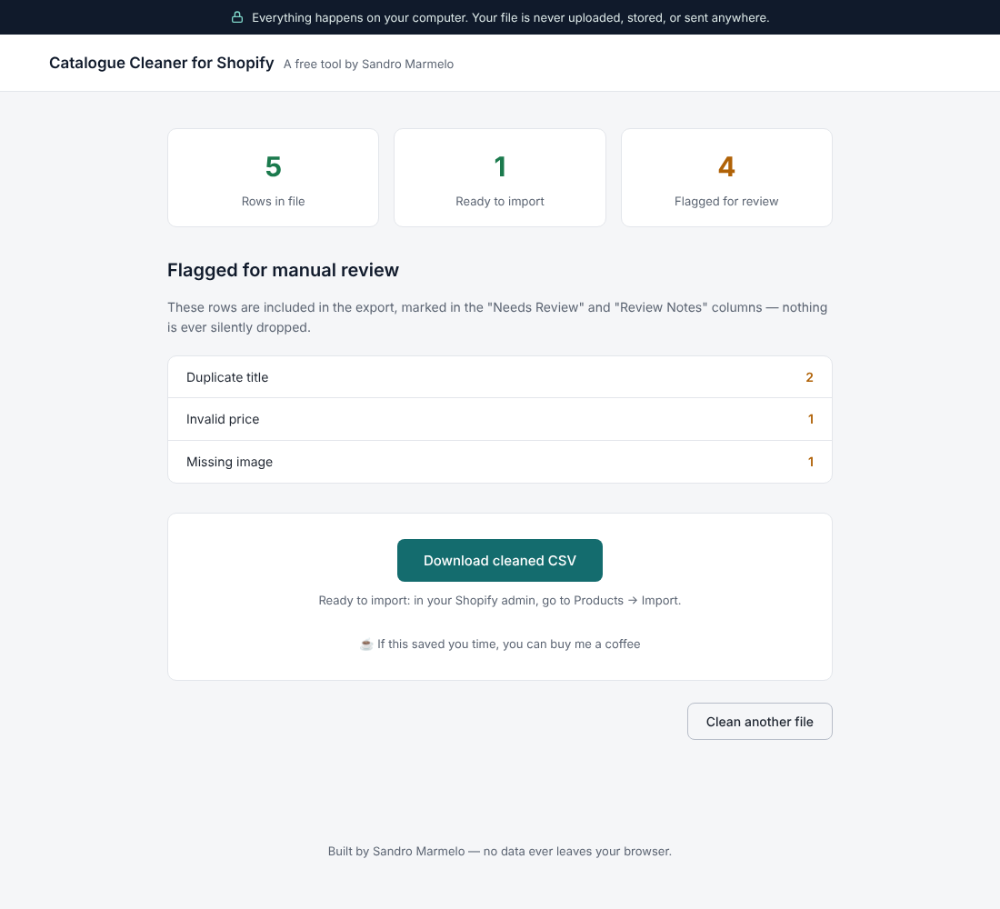

# Catalogue Cleaner for Shopify

A free, browser-only tool that turns a messy supplier product CSV into a file ready to import into Shopify. Nothing is uploaded anywhere — the whole thing runs client-side in JavaScript.

## What it does

1. **Upload** a supplier CSV (drag-and-drop or file picker).
2. **Map columns** — the tool auto-detects common supplier column names (e.g. "product name", "price", "stock") and maps them to Shopify's import fields; any guess can be corrected before cleaning.
3. **Clean**: strips stray whitespace, normalises prices (handles currency symbols and comma or dot decimal separators), generates valid URL handles from the title, and fills in the fixed fields Shopify's importer expects for simple single-variant products.
4. **Flag, never drop**: rows with a missing title, a missing image, a price that couldn't be read, or a duplicate title/handle are kept in the export and marked in a `Needs Review` / `Review Notes` column, instead of being silently discarded.
5. **Download** the cleaned CSV, ready for Shopify's Products → Import.

## Try it with the sample files

`sample/input-supplier-catalogue.csv` is a deliberately messy 5-row example (stray whitespace, a missing price, a missing image, a duplicate title). Upload it to see the tool in action, or compare it directly against `sample/output-shopify-import.csv` to see what the cleaned result looks like without running anything.

## Stack

Vanilla JavaScript, no build step, no framework. Uses [PapaParse](https://github.com/mholt/PapaParse) (bundled in `js/vendor/`, MIT licensed) for CSV parsing in the browser.

## Privacy

The file never leaves the browser: there is no server, no upload, no analytics, no network request of any kind. Everything — parsing, cleaning, exporting — happens locally in JavaScript.

## License

MIT — see [LICENSE](./LICENSE).

Built by [Sandro Marmelo](https://marmelosan.github.io/portfolio/).
